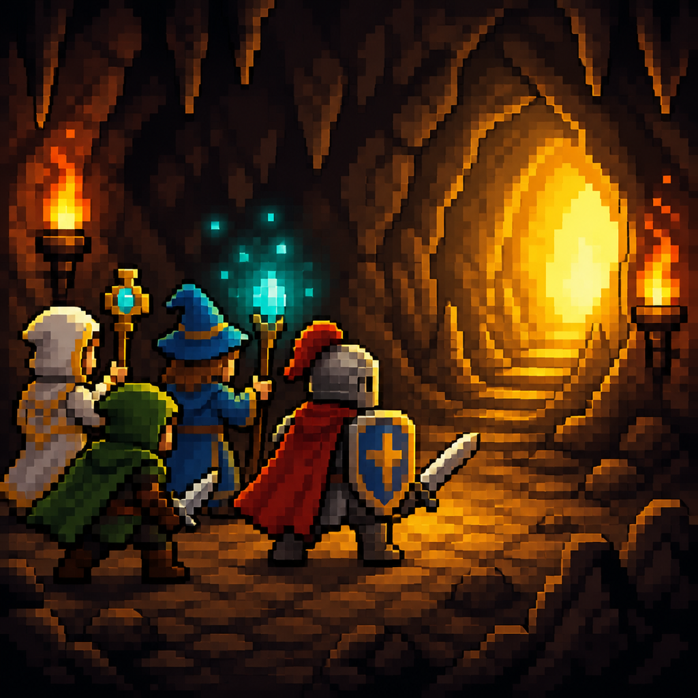
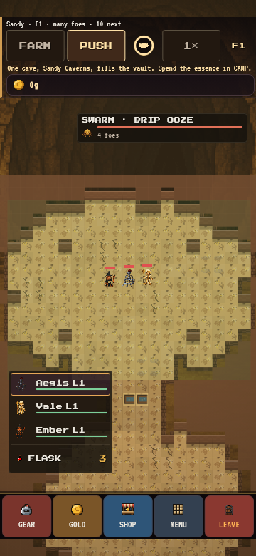
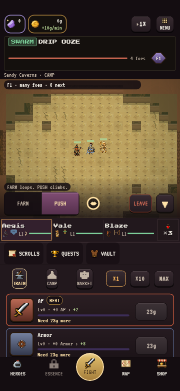
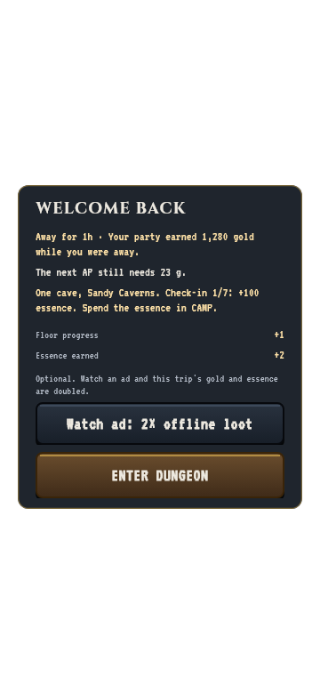
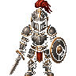
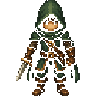

# Idle Party

**Your party walks real dungeon floors and keeps fighting while the app is closed.**

Idle Party is a portrait Android idle RPG. Install from Google Play — not from GitHub.

**[Get it on Google Play](https://play.google.com/store/apps/details?id=com.idleparty.app)** · `com.idleparty.app`

**Live on Play: 1.13.17 (243)** (released 2026-11-11). The ship number lives in `pubspec.yaml` and matches `ChangelogCatalog.currentVersion` in `lib/core/changelog.dart`. What’s New in the game is that catalog (`MORE → INFO → PATCH NOTES`).

**Next candidate branch:** `test/fight-ui-stack` at **1.13.18+249** — integration and phone polish, not a second live version.

<p align="center">
  
</p>

### Screenshots (A56 goldens)

Current phone frames from the test suite (`360×780`):

<p align="center">
  
  
  
</p>

<p align="center">
  
  
  
  
</p>

Art in the game is owned and lives under `assets/custom/`. In-game text is English.

Orientation for contributors: [docs/game-intelligence/PROJECT_ARCHITECTURE.md](docs/game-intelligence/PROJECT_ARCHITECTURE.md) · [ROADMAP.md](ROADMAP.md) · [docs/TESTING.md](docs/TESTING.md).

## What you do

- **Fight on the floor.** The party walks the hall, opens gates, and clears chambers. The fight is the live sim, including while the app is closed in a cave.
- **One party.** A new game starts with 3 heroes. The fourth joins at the first Ascend. A fifth slot unlocks at AL2. Ten classes, 31 specs. Race locks after New Game START.
- **Fifteen caves.** Sandy Caverns through Mothveil Hollow. The hub map is PATH.
- **Come back.** The cave keeps fighting while the app is closed. The hub pays gold. Welcome Back shows what the absence earned. An optional watch **doubles** that trip’s gold and essence (2×), not triple — Scroll of Rest is a separate ×3 gold ticket.
- **Gear and gold.** GEAR wears budget upgrades (AUTO EQUIP, on by default). GOLD is the forge and the market.
- **Endgame when every active hero is Lv100.** KEY, Gauntlet, Farm Rift, Ranked Greater Rift, and Ashen Crown. Craft Trial is under MORE → CRAFT, not a hub hunt.
- **Ascend.** Hero levels, open caves, essence, relics, pets, and shop buys stay. Wallet gold, worn drops, and floor progress reset. Cap is AL20.
- **Optional ads and shop.** Rewarded ads are opt-in. SHOP sells ad-free, Long Away, and Supporter.

Tabs on the phone: GEAR, GOLD, SHOP, ESSENCE, MORE. Early on, only GEAR and MORE show. God Hand is a long-press on the fight, or the fist.

Next priorities: [ROADMAP.md](ROADMAP.md). The year plan is [docs/YEAR_ROADMAP.md](docs/YEAR_ROADMAP.md). Week jobs are in `docs/weeks/`.

## Build, run, test

Portrait Android is the product. Web is a fallback, not a release.

```bash
flutter pub get
flutter analyze lib test --no-fatal-infos
```

**Agents and local dev** run analyze plus **targeted** tests for the batch they touch. **CI** runs the full suite:

```bash
flutter test --exclude-tags sim
```

The `sim` tag is the nightly balance run (`sim-nightly.yml`), not a missing check. See [docs/TESTING.md](docs/TESTING.md).

Phone look is the Samsung A56 (1080×2340 at 480 dpi, so 360×780):

```bash
flutter emulators --launch Samsung_A56
flutter run
```

Use the device id from `flutter devices` when it is not `emulator-5554`.

A local release APK, debug-signed when `android/key.properties` is absent:

```bash
flutter build apk --release
```

Do not upload an AAB unless you mean to ship that build. Signing for Play is in [docs/PLAY_STORE.md](docs/PLAY_STORE.md).

Saves are on-device (`SharedPreferences`, five slots). Package `com.idleparty.app`.

Privacy: [docs/PRIVACY.md](docs/PRIVACY.md).

## License

Game code is [MIT](LICENSE). Art under `assets/custom/` is all rights reserved. Do not add sprites, audio, or code from other games.