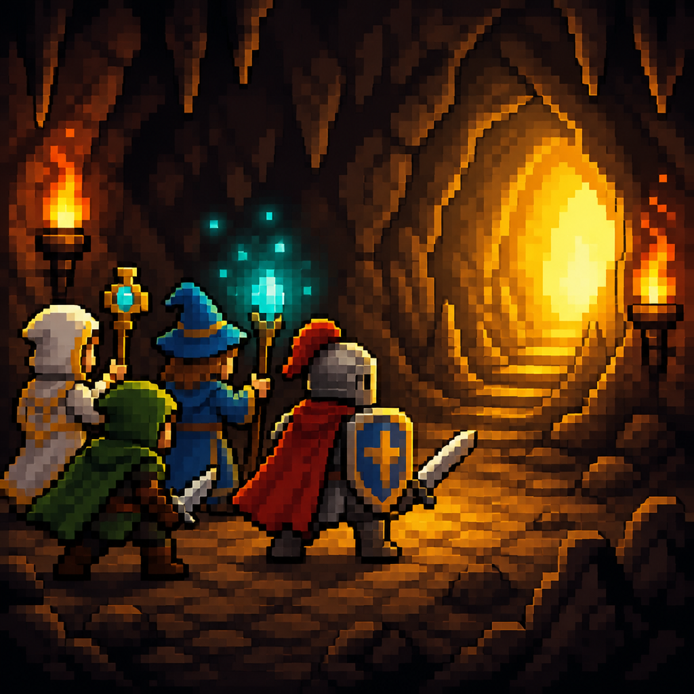
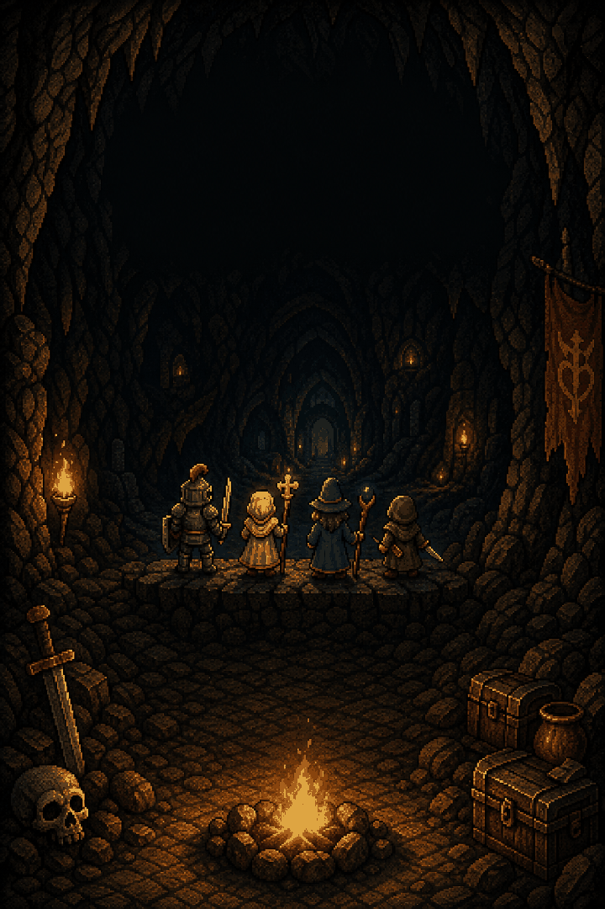
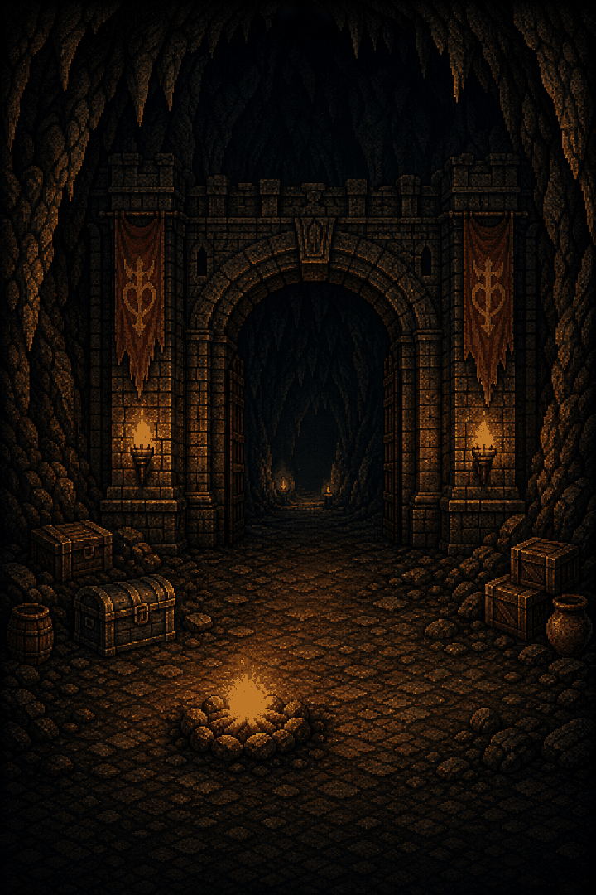
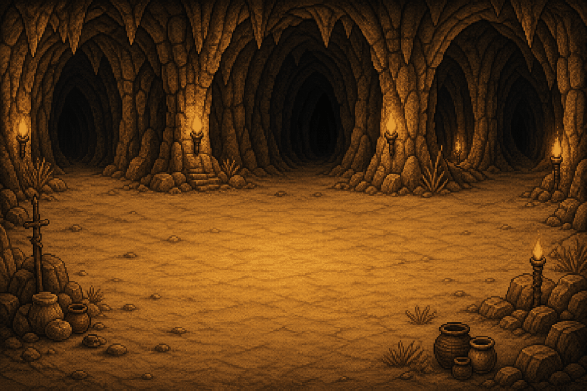
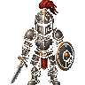
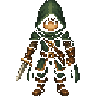

# Idle Party

**Your party keeps fighting while the app is closed.**

Idle Party is a portrait Android idle RPG. A party walks real dungeon floors, clears the room, and keeps going when you leave. Install it from Google Play.

**[Get it on Google Play](https://play.google.com/store/apps/details?id=com.idleparty.app)** · `com.idleparty.app`

**Ship version: 1.13.5 (231).** That is the production build submitted 2026-10-28. The number in `pubspec.yaml` matches `ChangelogCatalog.currentVersion`. What’s New in the game is that catalog (`MORE → INFO → PATCH NOTES`).

<p align="center">
  
</p>

<p align="center">
  
  
  
</p>

<p align="center">
  
  
  
  
</p>

Art in the game is owned and lives under `assets/custom/`. In-game text is English.

## What you do

- **Fight on the floor.** The party walks the hall, opens gates, and clears chambers. The fight is the live sim, including while the app is closed in a cave.
- **One party.** A new game starts with 3 heroes. The fourth joins at the first Ascend. A fifth slot unlocks at AL2. Ten classes, 31 specs. Race locks after New Game START. Class can still change.
- **Fifteen caves.** Sandy Caverns through Mothveil Hollow. The hub map is PATH.
- **Come back.** The cave keeps fighting while the app is closed. The hub pays gold. Welcome Back shows what the absence earned.
- **Gear and gold.** GEAR wears budget upgrades (AUTO EQUIP, on by default). GOLD is the forge and the market.
- **Endgame when every active hero is Lv100.** KEY, Gauntlet, Farm Rift, Ranked Greater Rift, and Ashen Crown. Craft Trial is under MORE → CRAFT, not a hub hunt.
- **Ascend.** Hero levels, open caves, essence, relics, pets, and shop buys stay. Wallet gold, worn drops, and floor progress reset. Cap is AL20. Blessing stacks stay.
- **Optional ads and shop.** Rewarded ads are opt-in. SHOP has ad-free, supporter, and scrolls.

Tabs on the phone: GEAR, GOLD, SHOP, ESSENCE, MORE. Early on, only GEAR and MORE show. God Hand is a long-press on the fight, or the fist.

Next priorities: [ROADMAP.md](ROADMAP.md). The year plan is [docs/YEAR_ROADMAP.md](docs/YEAR_ROADMAP.md). Week jobs are in `docs/weeks/`.

## Recent work

Play is still **1.13.5**. This branch does not bump that number.

On this branch, not yet a new Play build:

- Welcome Back can offer an optional watch after the first boss. A full watch makes that return’s gold ×3. Nothing new is written into the save.
- Until the first boss dies, the cave coach says the party keeps fighting if you close the app.
- Clearing a room or boss no longer crashes in the keystone helper. The 1.13.5 binary on Play does not have that crash.

**1.13.5** (notes Oct 25, 2026): the party fights on its own, race is look only, and music stays on in the hub and in a cave.

Older notes stay in the game and in `lib/core/changelog.dart`.

## Build, run, test

Portrait Android is the product. Web is a fallback, not a release.

```bash
flutter pub get
flutter analyze lib test --no-fatal-infos
flutter test --exclude-tags sim
```

The `sim` tag is the nightly balance run, not a missing check.

Phone look is the Samsung A56 (1080×2340 at 480 dpi, so 360×780):

```bash
flutter emulators --launch Samsung_A56
flutter run
```

Use the device id from `flutter devices` when it is not `emulator-5554`.

A local release APK, debug-signed when `android/key.properties` is absent:

```bash
flutter build apk --release
```

Do not upload an AAB unless you mean to ship that build. Signing for Play is in [docs/PLAY_STORE.md](docs/PLAY_STORE.md).

Saves are on-device (`SharedPreferences`, five slots). Package `com.idleparty.app`.

Privacy: [docs/PRIVACY.md](docs/PRIVACY.md).

## License

Game code is [MIT](LICENSE). Art under `assets/custom/` is all rights reserved. Do not add sprites, audio, or code from other games.
